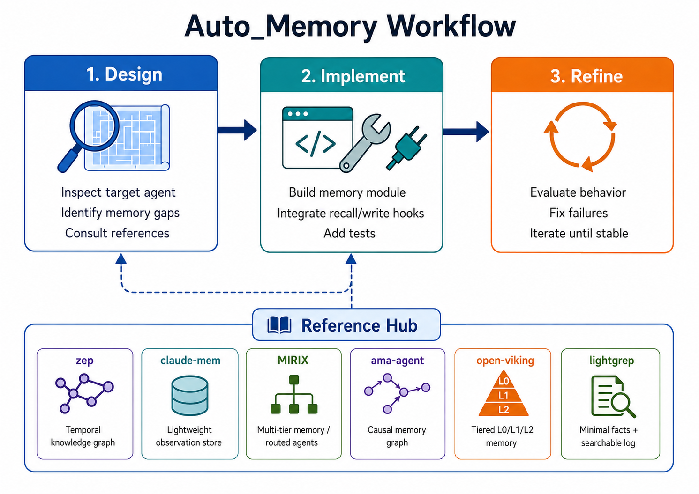

<h1 align="center">&nbsp; Auto_Memory</h1>

<p align="center">
  <strong>A harness to build agent memory system automatically like an expert</strong><br>
</p>

<p align="center">
  <a href="#-quick-start"></a>
  <a href="#-reference-hub"></a>
  <a href="#-use-cases-how-memory-enhances-agents"></a>
  <a href="#commands"></a>
</p>

<p align="center">
  
  
  
  
</p>

<p align="center">
  
</p>

---

## 📰 News

- **2026-05-12** 🚀 Released the first Auto_Memory README with the design → implement → refine command flow, workflow diagram, and long-running scaffold protocol.
- **2026-05-12** 📚 Added four documented memory use cases: Nanobot Health, TradingAgents, OpenCode, and Browser-Use.
- **2026-05-12** 🧠 Published the reference hub with 6 analyzed memory systems and 29 reusable memory techniques.

---

## 🤔 Why Auto_Memory

Most agent memory projects start from a memory stack: vector DB, graph store, episodic log, user profile, tool trace, or all of them at once. Auto_Memory starts from the agent.

The best memory structure is not the benchmark SOTA. Best is the one that fits most: the target agent architecture, latency budget, task shape, retention window, tool lifecycle, and user's actual definition of what should be remembered.

Rome was not built in a day. Auto_Memory distills design ideas from SOTA memory systems, then gives a coding agent a repeatable harness to adapt those ideas to a real agent repository. It does not ask your agent to copy a universal memory system; it asks your agent to build the memory that belongs there.

Auto_Memory is for agents that need to become stateful without becoming bloated.

---

## 🚀 Quick Start

### 1. Clone the repository

```bash
git clone https://github.com/FFFFFFFANG1/Auto_Memory.git
cd Auto_Memory

# if you only want the harness to build memory not the existing memory-on use case snapshots, 
# remove them after cloning as they are quite large:
# rm -rf use_cases
```

### 2. Install the reference lookup CLI

The reference hub includes `ask_ref`, a small CLI for browsing reusable memory techniques extracted from analyzed systems.

```bash
pip install -e reference/hub/

ask_ref ls
ask_ref ls extraction
ask_ref grep "dedup" -l intelligent
ask_ref cat zep-reflexion
```

### 3. Pick your coding agent

Copy the following prompt to your coding agent (Claude Code, Codex, Cursor, etc.):

```text
"help me install ask_ref tool and register all commands in this repo"
```

Or, do it manually:

<details open>
<summary><h4 id="cursor">Cursor</h4></summary>

Use the markdown command files in `commands/` as Cursor slash commands or project prompts:

```text
commands/auto-memory.md
commands/auto-memory-design.md
commands/auto-memory-implement.md
commands/auto-memory-refine.md
```

Command specs: [`auto-memory`](commands/auto-memory.md), [`auto-memory-design`](commands/auto-memory-design.md), [`auto-memory-implement`](commands/auto-memory-implement.md), [`auto-memory-refine`](commands/auto-memory-refine.md).

Run the full pipeline:

```text
/auto-memory <agent-repo> "requirement"
```

Or run each phase explicitly:

```text
/auto-memory-design <agent-repo> "requirement"
/auto-memory-implement <agent-repo>
/auto-memory-refine <agent-repo>
```

</details>

<details>
<summary><h4 id="claude-code">Claude Code</h4></summary>

Claude Code can use the same command form. Add the command markdown files from `commands/` to your command setup, then invoke:

```text
/auto-memory <agent-repo> "requirement"
/auto-memory-design <agent-repo> "requirement"
/auto-memory-implement <agent-repo>
/auto-memory-refine <agent-repo>
```

The end-to-end command orchestrates design, implementation, and refine. The phase commands are useful when you want each step to run in a fresh session.

</details>

<details>
<summary><h4 id="codex">Codex</h4></summary>

Use Codex's slash prompt feature. Save or paste the corresponding command document as a slash prompt, then run the same phase names as prompts:

```text
/auto-memory <agent-repo> "requirement"
/auto-memory-design <agent-repo> "requirement"
/auto-memory-implement <agent-repo>
/auto-memory-refine <agent-repo>
```

If your Codex setup does not load command files directly, paste the relevant `commands/*.md` content into the slash prompt body and pass the target repository as the prompt argument.

</details>

---

## 🎯 When to Use Auto_Memory

<table>
<tr>
<td width="33%" valign="top">

### 🧊 Agent Is Stateless Across Sessions

---

**Why this harms:** every new session starts cold. The agent repeats discovery, loses user preferences, forgets prior failures, and cannot reuse task progress once the active context window is gone.

**Why Auto_Memory helps:** it designs persistence, recall, and lifecycle hooks around the existing agent loop so useful experience survives across runs.

</td>
<td width="33%" valign="top">

### 🧩 Default General-Agent Memory Is Too Broad

---

**Why this harms:** many general agents ship with broad default memory for generic user facts and preferences. That memory may not match the user's expected memory points for a specific agent, domain, or task.

**Why Auto_Memory helps:** it starts from the target agent's actual workload and user expectation, then defines what should be remembered before choosing storage and retrieval mechanisms.

</td>
<td width="33%" valign="top">

### ⚠️ SOTA Memory May Not Suit Agent's Environment

---

**Why this harms:** a state-of-the-art memory system can assume dependency, information type, privacy, or memory I/O mechanisms that the target agent does not have. Copying it directly can make the agent slower, brittle, or incompatible with its runtime.

**Why Auto_Memory helps:** the harness translates SOTA memory ideas into the target repository's existing architecture, constraints, tool lifecycle, and evaluation surface.

</td>
</tr>
</table>

---

## 🧪 Use Cases: How Memory Enhances Agents

<table>
<tr>
<td width="50%" valign="top">

### 🩺 Nanobot Health

*Turn general memory into user-specific.*

---

> General agent memory fails at specialized domain knowledge: health assistance needs exact symptoms, dates, measurements, medications, and care events rather than broad user-profile notes.

Auto_Memory added a health memory tool, taught Nanobot how to use it through an always-on health skill, and backed it with two files: always-loaded `HEALTH.md` for stable health facts and `memory/health_log.jsonl` for temporal care events.

**433% higher pass rate** in small but fairly designed health QA benchmark based on ESL Health data, from **18.3%** to **97.5%**.

[More Details](use_cases/nanobot-health.md) · [Memory-on Agent repo](use_cases/nanobot-health-main-a2f4090e/) · [Evaluation](use_cases/nanobot-health-main-a2f4090e/bench/construction.md)

</td>
<td width="50%" valign="top">

### 📈 TradingAgents

*Memory as past experience for current decisions.*

---

> Trading decisions need durable history in the loop: prior recommendations, ticker context, macro notes, and reflection lessons should shape later analyst, debate, trader, and portfolio-manager reasoning.

Auto_Memory added role-specific financial memory stores for TradingAgents: ticker knowledge cards, prior decision logs, macro notes, analyst report caches, and BM25 reflection lessons injected into the existing LangGraph nodes.

Strongest signal: later decisions reused durable history across tickers, with **175 reflection lessons per role** and **19 decisions per ticker** available for recall.

[More Details](use_cases/tradingagents.md) · [Memory-on Agent repo](use_cases/TradingAgents-main-fa4d01c/) · [Evaluation](use_cases/TradingAgents-main-fa4d01c/bench/construction.md)

</td>
</tr>
</table>

<table>
<tr>
<td width="50%" valign="top">

### 🌐 Browser-Use

*Memory as observation cache and guidance for future execution.*

---

> Browser agents repeat the same navigation and extraction work when useful observations disappear after each session.

Auto_Memory added a supplemental browser memory layer that records navigation shortcuts, obtained-information caches, site notes, task snapshots, and trace archives, then recalls them before future browser decisions.

**80% fewer extract/search calls** on repeated GitHub tasks. Strongest practical gains also included **44% fewer steps**, **41% fewer tokens**, and **34% faster** completion.

[More Details](use_cases/browser-use.md) · [Memory-on Agent repo](use_cases/browser-use-main-9b4b8d8/) · [Evaluation](use_cases/browser-use-main-9b4b8d8/bench/README.md)

</td>
<td width="50%" valign="top">

### 💻 OpenCode

*Memory as better project-level context for coding agents.*

---

> Coding agents lose useful observations across sessions: bug-location notes, failed patch patterns, user test/lint preferences, handoff state, and tool experience vanish before the next related task.

Auto_Memory added workspace-level coding memory under `.opencode/memory/`, with facts, handoff state, reusable observations, tool stats, session cards, and an on-demand recall path injected into future OpenCode sessions.

**89% fewer tokens** in the multi-session Django workflow. Strongest outcome gain: sequential Pytest issues resolved **20% more tasks** (**5/6 → 6/6**) with memory enabled.

[More Details](use_cases/opencode.md) · [Memory-on Agent repo](use_cases/opencode-dev-17701628b/) · [Evaluation](use_cases/opencode-dev-17701628b/bench/README.md)

</td>
</tr>
</table>

---

## 🛠️ How Auto_Memory Works

<p align="center">
  
</p>

### 🔁 Pipeline

<table>
<tr>
<td width="33%">

#### 1. Design

`/auto-memory-design` explores the target agent, maps its context window and lifecycle, identifies memory gaps, consults the reference hub, and writes `memory_design.md`.

</td>
<td width="33%">

#### 2. Implement

`/auto-memory-implement` builds the memory module or adapter, integrates recall/write hooks, adds tests, writes `implemented.md`, and initializes refine state.

</td>
<td width="33%">

#### 3. Refine

`/auto-memory-refine` runs the Critic-Improver loop. The Critic creates traces and scores failures; the Improver fixes the memory until the Critic stops or the phase limit is reached.

</td>
</tr>
</table>

### <span id="commands">⚙️ Commands</span>

| Command | Purpose | Output |
| --- | --- | --- |
| `/auto-memory-design <agent-repo> [requirements]` | Explore the agent and design a tailored memory system. | `memory_design.md` |
| `/auto-memory-implement <agent-repo>` | Build the memory system from the design. | Memory module, adapter, tests, `implemented.md` |
| `/auto-memory-refine <agent-repo>` | Run the Critic-Improver refine loop. | Stronger memory and updated `refine_state.json` |
| `/auto-memory <agent-repo> [requirements]` | End-to-end orchestrator. | Complete memory system |

**Caution: end-to-end command is not recommended** as the entire workflow always exceeds coding agent's context window, and is more
likely to cause behavior drift. Also, running command **step by step** also allows you to adjust the memory design and implementation in real time.

### 🔬 Reference Hub

The [`reference/`](reference/README.md) directory is a curated library of analyzed memory systems and reusable techniques. It currently distills **6 memory systems** into **28 techniques** across extraction, deduplication, storage organization, retrieval and ranking, lifecycle, and architecture patterns. Each analyzed system also has a detailed writeup under `reference/*/details.md`.

| System | Transferable idea |
| --- | --- |
| [`zep/`](reference/zep/details.md) | Temporal knowledge graph, reflexion extraction, community aggregation. |
| [`claude-mem/`](reference/claude-mem/details.md) | Lightweight observation store with lifecycle hooks and summary extraction. |
| [`MIRIX/`](reference/MIRIX/details.md) | Multi-tier memory routed through dedicated memory-type agents. |
| [`ama-agent/`](reference/ama-agent/details.md) | Causal memory graph, relevance scoring, and hierarchical compression. |
| [`open-viking/`](reference/open-viking/details.md) | Intent-driven extraction with tiered L0/L1/L2 memory representation. |
| [`lightgrep/`](reference/lightgrep/details.md) | Minimal always-in-context facts plus grep-searchable event log. |

Use the `ask_ref` CLI during design and implementation:

```bash
ask_ref ls                              # list all categories with technique IDs
ask_ref ls retrieval_ranking            # list techniques in a category
ask_ref grep "tool"                     # search by keyword
ask_ref grep "dedup" -l intelligent     # filter by logic style
ask_ref cat zep-reflexion               # show a full technique card
```

The point is not to copy these systems. The point is to let a coding agent borrow the design move that fits the target agent.

### 📌 Scaffolding for Long-Running Operation

Auto_Memory entire workflow may expands to 1-3 hours, and the coding agent face high possibility to lose prior context and drift its goals. The harness solves this with explicit file-based scaffolding that carries state across every phase and session boundary.

```text
<agent>_memory/
├── memory_design.md        # design-to-implementation handoff
├── implemented.md          # component inventory for refine
└── worktraces/
    ├── note.md             # persistent working memory for the build agent
    ├── refine_state.json   # active control plane for refine
    └── traces/             # synthetic test scenarios
```

| Artifact | Role |
| --- | --- |
| `note.md` | The agent's persistent scratchpad. Survives session boundaries and context window resets. Tracks user requirements, checkpoints, agent observations, design decisions, known weaknesses, open questions, and runtime configs. Each phase appends to it; future phases read it on entry. |
| `memory_design.md` | Bridges design and implementation. Contains the memory architecture, type inventory, read/write contracts, token budgets, and gap analysis. The implement phase treats it as its specification. |
| `implemented.md` | Component inventory consumed by refine. Lists each memory component with its write trigger, read method, eval mode, persistence model, and flush requirements. The Critic reads it to know what to test. |
| `refine_state.json` | The control plane for the Critic-Improver loop. Tracks the current phase, step status, memory paths with eval modes, trace registry with per-trace scores, phase-level weakness and improvement history, graduated paths, and stop decisions. Both Critic and Improver read and write it at every step boundary. |
| Trace files | Synthetic JSON scenarios in `worktraces/traces/`. Each trace simulates agent interactions and includes recall queries with expected information (qa mode) or write-then-read checks (hit_rate mode). The Critic creates and escalates traces; the runner replays them against the live memory system. |

The `scaffolds/` directory provides the templates and reference specs that bootstrap these artifacts:

- **[`refine-protocol.md`](scaffolds/refine-protocol.md)** defines trace suite design, scoring metrics (`support_coverage`, `query_success`, `hit_rate`), per-path escalation and graduation rules, and exit conditions.
- **[`trace-format.md`](scaffolds/trace-format.md)** specifies the JSON schema for qa and hit_rate traces.
- **[`refine_state_template.json`](scaffolds/refine_state_template.json)** seeds an empty but well-formed control plane.
- **[`note-template.md`](scaffolds/note-template.md)** gives the agent a starting structure for its scratchpad.
- **[`check_refine_state.py`](scaffolds/check_refine_state.py)** is a validation gate the agent can run at any step boundary to verify structural correctness.
- **[`fill_critic_prompt.py`](scaffolds/fill_critic_prompt.py)** helps assemble Critic prompts from the refine protocol, implementation summary, notes, and current refine state.

Because every decision, score, and weakness is persisted to disk, the pipeline can be interrupted and resumed at any step boundary. A new agent session reads `refine_state.json` for progress, `note.md` for context, and continues from `step_status` without replaying prior work.

---

## 🌍 Vision: Turn every stateless agent stateful.

**Memory System as Experience**: The real value of existing memory systems is not the systems themselves, but the design insights embedded in them. Each memory system reflects a set of decisions about what should be remembered, when memory should be written, how it should be updated, and how it should be recalled. Auto_Memory treats these systems as sources of transferable experience. Through `ref_hub`, the project extracts and organizes these insights so they can be reused across different agents and memory-building tasks.

**Harness as Translation**: The harness is an intermediate translation layer between state-of-the-art memory insights and real agent needs. Instead of applying a generic memory module, the harness translates abstract memory insights into an agent-specific memory solution. Its goal is to find the optimal memory design for a particular agent, task environment, and user expectation.

**Memory as Resource for Agent Evolution**: Memory is not only a runtime support mechanism for better context recall. The accumulated memory itself becomes a valuable resource for agent improvement. By preserving information about past tasks, user interactions, failures, successful strategies, and recurring patterns, an agent can better understand its own operating history and the users it serves. This allows the agent to improve over time, adapt to repeated task structures, and make more informed decisions based on its own accumulated experience.

---

## 🤝 Contribution

We especially welcome four kinds of PRs:

1. **More reference-hub systems**: add SOTA memory references from agents in different domains, with details, prompts, and technique cards. Follow the [`create_new_ref` skill](reference/create_new_ref/SKILL.md) for the expected workflow and output format.
2. **Harness methodology updates**: improve command specs, scaffolds, trace formats, refine protocol, validation gates, or evaluation guidance.
3. **More Auto_Memory-enhanced agents**: add real agent repositories and use cases where Auto_Memory built or redesigned memory.
4. **Better memory-on agents**: improve the memory systems already written into current Auto_Memory-enhanced repositories.

If you want to contribute harness methodology, prefer encoding it in `commands/`, `scaffolds/`, or `reference/hub/technique_map.json` so future builds can reuse it.

For a new use-case PR, submit only the memory-build artifacts under `<agent>_memory/`: `memory_design.md`, `prompt.txt`, `implemented.md`, `note.md`, and `worktraces/traces/`. Do not vendor the full modified agent repository in the PR. This keeps the contribution portable: maintainers can rebuild and review the memory system against an up-to-date upstream agent repo instead of inheriting a frozen source snapshot.

---

## ⚠️ Limitations

- Auto_Memory works best with strong coding models, such as GPT-5.5 / Claude-Opus class models, because the harness asks the agent to understand another agent's architecture, design memory, implement it, and run adversarial refinement.
- Refine loops can be long-running. If LLM-based extraction, judging, or evaluation participates, one full run may continue for around 2 hours.
- Auto_Memory is a harness and methodology, not a plug-and-play universal memory runtime.
- Memory quality depends on trace quality. Weak traces can make a memory system look robust while missing real failures.
- Some target agents require multiple refine rounds before the resulting memory is stable enough to trust.

---

## 🗂️ Project Structure

```text
Auto_Memory/
├── README.md                       # Project overview
├── assets/                         # Logo and README animation
├── commands/
│   ├── auto-memory.md              # End-to-end orchestrator
│   ├── auto-memory-design.md       # Explore agent + produce memory design
│   ├── auto-memory-implement.md    # Build memory from design document
│   └── auto-memory-refine.md       # Critic-Improver refine loop + protocol
├── scaffolds/
│   ├── check_refine_state.py       # Validation gate for refine state
│   ├── refine_state_template.json  # Template for refine_state.json
│   ├── refine-protocol.md          # Critic reference spec
│   ├── note-template.md            # Template for working memory notes
│   ├── trace-format.md             # Trace schema and scoring conventions
│   └── fill_critic_prompt.py       # Critic prompt helper
├── reference/
│   ├── README.md                   # Reference hub overview
│   ├── hub/                        # ask_ref CLI + technique catalog
│   ├── zep/
│   ├── claude-mem/
│   ├── MIRIX/
│   ├── ama-agent/
│   ├── open-viking/
│   ├── lightgrep/
│   └── template/
└── use_cases/
    ├── browser-use.md
    ├── browser-use-main-9b4b8d8/        # Memory-on source snapshot: repo-branch-HEAD
    ├── nanobot-health.md
    ├── nanobot-health-main-a2f4090e/
    ├── opencode.md
    ├── opencode-dev-17701628b/
    ├── tradingagents.md
    └── TradingAgents-main-fa4d01c/
```

---

<p align="center">
  <br>
  <strong>Build the memory that fits the agent.</strong>
</p>
